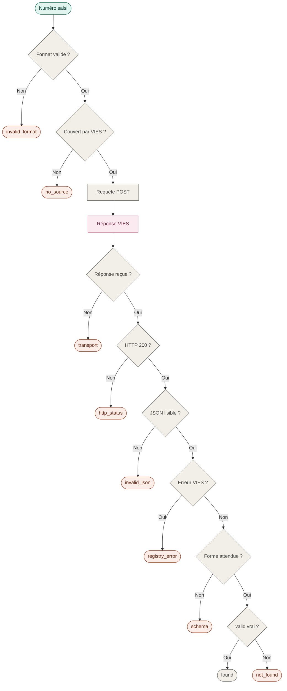

# Conception — `vat-number-validator` (Python)

- **Date :** 2026-10-22
- **Statut :** décisions V1 à V14 prises par l'utilisateur, une à une (§2) ; les 12 points du §14 validés tels quels par l'utilisateur le 2026-10-22.
- **Référence :** le package PHP terminé `egbavou/vat-validator` (`../vat-validator/`, poussé le 2026-10-22), dont ce package est la version Python :
  - `docs/plans/2026-10-21-design.md`, dont toutes les décisions du §9 ;
  - `docs/research/2026-10-22-country-rules.md` et `docs/research/2026-10-22-changes-since-2020.md` ;
  - `src/`, `tests/` et `tests/Fixtures/vies/` (66 réponses VIES réelles).
- **Implémentation :** Codex (V14), à partir du plan `2026-10-22-implementation.md`.

**Exigence centrale.** Pour une même entrée, le Python donne exactement les mêmes résultats que le PHP :
- mêmes règles par pays, dans le même ordre, et mêmes raisons d'échec ;
- mêmes statuts VIES, mêmes raisons d'indisponibilité, même `registry_error_code`, même `reference` et même règle de remplissage de `failure` ;
- même requête vers VIES et même décodage défensif ;
- mêmes vecteurs de test.

Quand ce document ne précise pas un comportement, **c'est le code PHP qui fait foi**. Les seuls écarts admis sont listés au §12.

> **Langue.** Ce document est en français. Tout ce qui est écrit dans le dépôt est en anglais : code, identifiants, commentaires, messages, tests, README. Exceptions : `docs/` et le catalogue de traduction français de Django.

---

## 1. Périmètre

Identique au PHP.

**Le package fait :**
- la validation **hors ligne** des numéros de TVA :
  - les 27 pays de l'UE et `XI` (Irlande du Nord), avec la clé de contrôle ;
  - `GB`, `CH` et `NO`, en format seul (clé documentée comprise) ;
- la vérification **facultative** de l'existence d'un numéro auprès de VIES, par l'API REST `POST /check-vat-number` ;
- des intégrations facultatives, Django et Pydantic.

**Le package ne fait pas :**
- les taux de TVA, l'autoliquidation ni aucun calcul de facture ;
- le SIREN et le SIRET (`france-business-id`) ;
- de nouvelle tentative après un échec VIES : c'est l'application qui décide.

---

## 2. Décisions de l'utilisateur (22/10/2026)

| # | Sujet | Décision |
|---|---|---|
| V1 | Approche | Code propre sous MIT, cœur sans aucune dépendance. python-stdnum (LGPL) ne sert que d'oracle de croisement en développement, avec ses 19 écarts documentés (§13.1), comme `dragonbe/vies` côté PHP. |
| V2 | Nom | PyPI `vat-number-validator`, import `vat_number_validator`. `vat-validator` est pris sur PyPI (projet abandonné en 2019). Codex a fait le même choix. |
| V3 | Python | `requires-python = ">=3.11"`, CI de 3.11 à 3.15. |
| V4 | Outillage | uv (environnement et commandes), backend de build `hatchling`, pytest, ruff (lint et formatage), mypy `--strict`, `py.typed`, arborescence `src/`. Identique aux ports France et Bénin. |
| V5 | Client HTTP | httpx en extra facultatif `vat-number-validator[httpx]`. `VatNumberChecker` reçoit un `httpx.Client`, `AsyncVatNumberChecker` un `httpx.AsyncClient` ; sinon le package crée le sien. Requête et décodage partagés entre les deux. Même forme que le Bénin (P5, P14, P15). |
| V6 | Forme de l'API | Constructeur qui valide : `VatNumber(value, *, country=None)` lève l'erreur. S'y ajoutent `try_parse`, `is_valid` et `from_siren`. `InvalidIdentifierError(ValueError)` porte `.reason`. Enums `StrEnum` aux membres en MAJUSCULES et aux valeurs PHP. `TypeError` pour une entrée qui n'est pas un `str`. Champs en snake_case. |
| V7 | Configuration | Arguments du constructeur (`requester`, `timeout`, `endpoint`), avec un délai de 20 s pour le client créé par le package. `ViesSettings.from_env()`, facultatif, lit `VAT_VALIDATOR_VIES_TIMEOUT` et `VAT_VALIDATOR_REQUESTER`, les mêmes noms qu'en PHP, avec les règles de lecture de Laravel. Rien n'est lu à l'import. |
| V8 | Délai | Le délai httpx porte sur chaque opération (connexion, chaque lecture, écriture, pool), et non sur la requête entière comme chez Guzzle. C'est documenté ; aucune échéance totale n'est codée. Comme le Bénin (P16). |
| V9 | Frameworks | Django et Pydantic, en modules facultatifs (extras `[django]` et `[pydantic]`), sous la forme commune aux ports France et Bénin (P17). |
| V10 | Pays lu dans un autre champ (Django) | Les validateurs et le champ de formulaire acceptent un `country=` fixe. Pour un pays saisi dans un autre champ, le README donne une recette `Form.clean()`. Aucun code dédié. C'est l'avis de Codex. |
| V11 | Licence et CI | MIT. CI GitHub Actions via uv, calquée sur le Bénin : `core`, `httpx`, `django`, `pydantic`, `quality`, `lowest` (§13.4). |
| V12 | Tests réels | Marqueur `live`, exclu par défaut et sauté sans `VAT_NUMBER_VALIDATOR_LIVE=1`, jamais en CI. En synchrone et en asynchrone, ils couvrent le service de test officiel de VIES et deux vrais numéros. Une erreur passagère de VIES fait sauter le test, sans le mettre en échec (§13.3). |
| V13 | Parité | Tous les cas Pest sont portés. Un test différentiel (marqueur `parity`) lance le package PHP local sur des milliers d'entrées générées et compare tout (§13.2). |
| V14 | Implémentation | Par Codex (`codex exec`, sandbox `workspace-write`, sans réseau). Claude installe les dépendances, surveille, puis vérifie tests, typage et lint avant de présenter le diff. Aucun commit sans accord. |

**Avis de Codex** (prompt neutre, 22/10/2026). Il a fait les mêmes choix que l'utilisateur sur V2, V5, V6, V9 (forme) et V10. Il conseillait de prendre le PHP comme oracle différentiel, ce qui a été retenu en V13. Il a aussi relevé plusieurs pièges de parité, repris aux §7 et §9 :
- la lecture `json_decode(..., true)` ;
- `errorWrappers` nul ou donné sous forme d'objet ;
- l'année 0000 dans un horodatage ;
- les majuscules ASCII.

---

## 3. Correspondance des noms PHP → Python

| PHP (`Egbavou\VatValidator\…`) | Python (`vat_number_validator.…`) |
|---|---|
| `VatNumber::from($s, country: $c)` | `VatNumber(s, country=c)` |
| `VatNumber::tryFrom($s, $c)` | `VatNumber.try_parse(s, country=c)` |
| `VatNumber::isValid($s, $c)` | `VatNumber.is_valid(s, country=c)` |
| `VatNumber::fromSiren($siren)` | `VatNumber.from_siren(siren)` |
| `->value`, `->prefix`, `->number`, `->countryCode` | `.value`, `.prefix`, `.number`, `.country_code` |
| `format()`, `__toString()` | `format()`, `__str__()` |
| `InvalidIdentifierException` | `InvalidIdentifierError` (sous-classe de `ValueError`) |
| `FailureReason::InvalidStructure` | `FailureReason.INVALID_STRUCTURE` (valeur `"invalid_structure"`) |
| `CheckStatus`, `UnavailableReason` | mêmes noms, membres en MAJUSCULES, mêmes valeurs |
| `VatNumberChecker` | `VatNumberChecker` et `AsyncVatNumberChecker` |
| `VatNumberChecker::DEFAULT_ENDPOINT` | constante de module `DEFAULT_ENDPOINT` |
| `VatNumberCheckResult` (`checkedAt`, `vatNumber`, `unavailableReason`, `registryErrorCode`…) | `VatNumberCheckResult` (`checked_at`, `vat_number`, `unavailable_reason`, `registry_error_code`…) |
| `Internal\ViesException` | `ViesError`, publique, puisqu'elle apparaît dans `failure` (comme `DirectoryError` au Bénin) |
| `Internal\Checksum`, `Internal\Countries\*` | modules privés `_checksum.py`, `_countries/` |
| config `vat-validator.vies.*` | `ViesSettings` et `ViesSettings.from_env()` |
| `Laravel\Rules\VatNumberRule` | `vat_number_validator.django.validators.VatNumberValidator` |
| `Laravel\Rules\VatNumberExistsRule`, `failWhenUnavailable()` | `VatNumberExistsValidator`, argument `fail_when_unavailable=True` |
| service provider (singleton du checker) | `vat_number_validator.django.checkers.get_vat_number_checker()` |

---

## 4. Arborescence

```
pyproject.toml
README.md                          (anglais)
LICENSE                            (MIT)
.gitignore                         (exclut uv.lock)
.github/workflows/ci.yml
docs/plans/2026-10-22-design.md            (ce document)
docs/plans/2026-10-22-implementation.md
docs/research/                             (les deux documents de recherche du PHP, copiés tels quels, §14)
src/vat_number_validator/
    __init__.py                    exports publics
    py.typed
    _cleanup.py                    séparateurs, majuscules ASCII, trim PHP
    _checksum.py                   Luhn, ISO 7064 MOD 11,10 et MOD 97-10, somme pondérée, somme des chiffres
    _countries/                    une règle par préfixe (portage de src/Internal/Countries/)
        __init__.py                registre : for_prefix, prefix_for_country, detect_prefix, prefixes
        _base.py                   règle abstraite : ordre caractères → longueur → structure → clé
        austria.py … switzerland.py, norway.py, united_kingdom.py (GB et XI)
    _enums.py                      FailureReason, CheckStatus, UnavailableReason
    _errors.py                     InvalidIdentifierError, ViesError
    _vat_number.py                 VatNumber
    _php_json.py                   décodage équivalent à json_decode($body, true, 512, JSON_THROW_ON_ERROR)
    _vies.py                       charge utile, requête, décodage de la réponse (partagé sync/async)
    _results.py                    VatNumberCheckResult
    _settings.py                   ViesSettings, DEFAULT_TIMEOUT, from_env
    checkers.py                    VatNumberChecker, AsyncVatNumberChecker, DEFAULT_ENDPOINT
    pydantic.py                    PydanticVatNumber
    django/
        __init__.py
        apps.py                    AppConfig, label "vat_number_validator"
        validators.py              VatNumberValidator, VatNumberExistsValidator
        forms.py                   VatNumberField
        checkers.py                get_vat_number_checker()
        locale/fr/LC_MESSAGES/django.po
        locale/fr/LC_MESSAGES/django.mo
tests/
    conftest.py
    cases.py                       portage de VatCases.php (142 valides, 107 invalides, 16 cas d'analyse)
    fixtures/vies/                 les 66 fichiers PHP, copiés octet pour octet
    core/                          cœur seul : ni httpx, ni Django, ni Pydantic
    httpx_integration/             vérificateurs sync et async, avec httpx.MockTransport
    django_integration/
    pydantic_integration/
    live/test_vies.py              marqueur live
    parity/oracle.php              oracle PHP du test différentiel
    parity/test_parity.py          marqueur parity
```

Les dossiers de tests ne s'appellent pas `django/` ni `pydantic/`, pour ne pas masquer les vrais packages à l'import.

---

## 5. Dépendances et outillage

- **Exécution :** aucune dépendance.
- **Extras :**
  - `httpx` : `httpx>=0.27` ;
  - `django` : `django>=5.2` ;
  - `pydantic` : `pydantic>=2.0.1,<3`. Le port France a montré que 2.0 casse l'alias facultatif. Le job `lowest` confirmera ce plancher ou le relèvera.
- **Groupes de développement** (PEP 735), chacun avec un plancher réaliste pour `lowest-direct` :
  - `test` : pytest, python-stdnum, Babel ;
  - `typing` : mypy, django-stubs ;
  - `lint` : ruff.
- **Tests asynchrones :** dans `asyncio.run()`, sans greffon pytest, comme le Bénin.
- **mypy :** `--strict`, sur `src/` et `tests/`.
- **ruff :** `target-version = "py311"`, formateur activé, jeu de règles large (E, F, W, I, UP, B, SIM, RUF, PT, C4, RET, N…).
- **pytest :** `--strict-markers` ; marqueurs `live` et `parity` déclarés, exclus par défaut (`-m 'not live and not parity'`).
- **Build :** `hatchling>=1.27`, licence en SPDX (`license = "MIT"`). Le sdist contient `src/` (`.mo` compris), `tests/` (fixtures comprises), `pyproject.toml`, le README et la LICENSE, mais pas `docs/` ni `.github/`.
- **Version :** `0.1.0` (§14).

---

## 6. API publique

Tout s'importe depuis `vat_number_validator`, sauf les intégrations.

```python
from vat_number_validator import VatNumber

VatNumber.is_valid("fr 27 552 032 534")  # True
VatNumber.try_parse("FR123")  # None
VatNumber("27552032534", country="FR").value  # 'FR27552032534'
VatNumber("GR094014201").value  # 'EL094014201'
VatNumber("CHE-116.281.710 MWST").value  # 'CHE116281710'
VatNumber("BE403170701").value  # 'BE0403170701'
VatNumber.from_siren("552 032 534").value  # 'FR27552032534'
VatNumber("BE0403170701", country="FR")  # InvalidIdentifierError, reason COUNTRY_MISMATCH
```

### 6.1 Énumérations (`StrEnum`)

Les valeurs et l'ordre des membres sont ceux du PHP.

| Enum | Membres et valeurs |
|---|---|
| `FailureReason` | `INVALID_CHARACTERS` `"invalid_characters"`, `INVALID_LENGTH` `"invalid_length"`, `INVALID_CHECKSUM` `"invalid_checksum"`, `INVALID_STRUCTURE` `"invalid_structure"`, `UNKNOWN_COUNTRY_PREFIX` `"unknown_country_prefix"`, `MISSING_COUNTRY_PREFIX` `"missing_country_prefix"`, `COUNTRY_MISMATCH` `"country_mismatch"` |
| `CheckStatus` | `FOUND` `"found"`, `NOT_FOUND` `"not_found"`, `INVALID_FORMAT` `"invalid_format"`, `UNAVAILABLE` `"unavailable"` |
| `UnavailableReason` | `NO_SOURCE` `"no_source"`, `REGISTRY_ERROR` `"registry_error"`, `TRANSPORT` `"transport"`, `HTTP_STATUS` `"http_status"`, `INVALID_JSON` `"invalid_json"`, `SCHEMA` `"schema"` |

### 6.2 Erreurs

- **`InvalidIdentifierError(ValueError)`**, `@final` :
  - constructeur `(reason: FailureReason)` ;
  - propriété en lecture seule `.reason` ;
  - message identique au PHP : `Invalid VAT number: invalid_structure.` ;
  - `__reduce__` : l'exception survit à `pickle` (multiprocessing, Celery), comme dans les deux autres ports.
- **`ViesError(RuntimeError)`**, `@final`, avec les messages exacts du PHP :
  - `VIES returned HTTP {status}.` ;
  - `VIES response is not a JSON object.` ;
  - `VIES response has no boolean "valid" field.` ;
  - `VIES response has no string "{field}" field.` ;
  - `VIES response has no valid "requestDate" timestamp.`

  Aucun de ces messages ne contient le corps de la réponse, le numéro, un nom ni une adresse. `__reduce__` est défini à partir du message.

### 6.3 `VatNumber`

Classe `@final`, `@dataclass(frozen=True, slots=True, init=False, repr=False)`.

| Élément | Python |
|---|---|
| Champs | `value: str` (`EL094014201`), `prefix: str` (`EL`), `number: str` (`094014201`), `country_code: str` (code ISO : `GR`) |
| Construction stricte | `VatNumber(value: str, *, country: str \| None = None)` analyse et lève `InvalidIdentifierError` |
| Construction tolérante | `VatNumber.try_parse(value, *, country=None) -> VatNumber \| None` |
| Contrôle | `VatNumber.is_valid(value, *, country=None) -> bool` |
| Depuis un SIREN | `VatNumber.from_siren(siren) -> VatNumber` (types acceptés au §14) |
| Affichage | `format()` renvoie la forme compacte, égale à `.value` |
| Chaîne | `str(vat)` renvoie `.value` |
| Représentation | `repr(vat)` : `VatNumber('EL094014201')` |
| Égalité, hachage | sur `.value` ; pas d'ordre |

- **Types.** `value` doit être un `str`, et `country` un `str` ou `None`. Sinon, `TypeError`, y compris dans `try_parse` et `is_valid`. C'est le comportement d'un appel PHP en `strict_types`, et la règle des deux autres ports.
- **Sous-classes de `str`.** Le texte est d'abord ramené à un `str` exact par `str.__str__(value)`, sans appeler les méthodes redéfinies de la sous-classe. Les champs sont toujours des `str` exacts.
- `try_parse` et `is_valid` n'interceptent que `InvalidIdentifierError`.
- **Champs dérivés.** Seul `value` est un champ d'initialisation ; `prefix`, `number` et `country_code` sont déclarés `field(init=False)`. Ainsi, `dataclasses.replace(vat, value="…")` analyse de nouveau la valeur, et une valeur invalide lève l'erreur. On ne peut pas construire un objet dont le préfixe contredirait la valeur. Le constructeur nomme son paramètre `value` pour que `replace()` fonctionne.
- Copie et `pickle` fonctionnent.

### 6.4 `VatNumberCheckResult`

Classe `@final`, `@dataclass(frozen=True, slots=True, kw_only=True)`. Seuls les vérificateurs la créent.

| Champ | Type | Règle de remplissage (PHP) |
|---|---|---|
| `status` | `CheckStatus` | — |
| `checked_at` | `datetime`, *aware*, UTC | `requestDate` de VIES pour `FOUND` et `NOT_FOUND` ; sinon l'heure UTC du moment |
| `vat_number` | `VatNumber \| None` | `None` seulement pour `INVALID_FORMAT` |
| `name`, `address` | `str \| None` | texte normalisé (§9.5) pour `FOUND` et `NOT_FOUND`, `None` sinon |
| `reference` | `str \| None` | `requestIdentifier` non vide, seulement si un requester valide est configuré |
| `unavailable_reason` | `UnavailableReason \| None` | non nul exactement pour `UNAVAILABLE` |
| `registry_error_code` | `str \| None` | non nul seulement pour `REGISTRY_ERROR`, et seulement si VIES a donné un code |
| `failure` | `Exception \| None` | rempli pour `TRANSPORT`, `HTTP_STATUS`, `INVALID_JSON` et `SCHEMA` ; `None` sinon, `NO_SOURCE` et `REGISTRY_ERROR` compris |

`name`, `address` et `failure` sont exclus de `repr()` (§14).

### 6.5 Vérificateurs

```python
DEFAULT_ENDPOINT = "https://ec.europa.eu/taxation_customs/vies/rest-api/check-vat-number"


class VatNumberChecker:
    def __init__(
        self,
        client: httpx.Client | None = None,
        *,
        requester: str | None = None,
        timeout: float | None = None,
        endpoint: str = DEFAULT_ENDPOINT,
    ) -> None: ...
    @classmethod
    def from_settings(cls, settings: ViesSettings, client: httpx.Client | None = None) -> Self: ...
    def check(self, vat_number: str | VatNumber, *, country: str | None = None) -> VatNumberCheckResult: ...
    def close(self) -> None: ...  # plus __enter__ / __exit__


class AsyncVatNumberChecker:  # même signature, avec httpx.AsyncClient
    async def check(self, vat_number: str | VatNumber, *, country: str | None = None) -> VatNumberCheckResult: ...
    async def aclose(self) -> None: ...  # plus __aenter__ / __aexit__
```

**Client HTTP** (règles du Bénin, P14) :
- **Client injecté :** utilisé pour l'envoi (§9.2). Le vérificateur ne le ferme jamais et ne modifie jamais sa configuration. Le passer avec `timeout` lève `ValueError`, puisque le délai d'un client injecté lui appartient.
- **Pas de client :** le vérificateur importe httpx dès sa construction. Si httpx manque, une `ImportError` explique d'installer `vat-number-validator[httpx]`. Il crée alors son propre client, `httpx.Client(timeout=timeout or 20.0)`. `close()` et `aclose()` ne ferment que ce client-là.
- **Délai :** un `timeout` qui n'est pas strictement positif lève `ValueError` (`not timeout > 0`, ce qui écarte aussi `nan`). Le repli sur 20 s ne vaut que pour la lecture de la configuration (§8).
- **Requester :** un `str` ou `None`, sinon `TypeError`. Comme en PHP, il est analysé par `VatNumber.try_parse`, sans pays. Il n'est retenu que s'il est valide **et** couvert par VIES (UE-27 et `XI`). Sinon, il est ignoré sans erreur.
- **`from_settings(settings, client)` :** équivaut au constructeur avec `requester=settings.requester`. `settings.timeout` ne sert que si aucun client n'est fourni.
- **Annotations :** les types httpx sont importés sous `TYPE_CHECKING`, pour que le module se charge sans httpx.

**Garanties de `check()` :**
- Il ne lève jamais d'exception. Seules exceptions :
  - `TypeError` si `vat_number` n'est ni un `str` ni un `VatNumber`, ou si `country` n'est ni un `str` ni `None` ;
  - les `BaseException` qui ne sont pas des `Exception` (`KeyboardInterrupt`, `SystemExit`, `asyncio.CancelledError`), qui se propagent.
- Un `VatNumber` reçu est utilisé tel quel, et `country` est alors ignoré, comme en PHP.
- Aucune nouvelle tentative.

---

## 7. Validation hors ligne

Les règles sont celles de `src/VatNumber.php` et de `src/Internal/Countries/*.php`, **portées ligne à ligne**. Une seule règle par préfixe, et toujours le même ordre : caractères, longueur, structure, puis clé. La première raison rencontrée est celle renvoyée. Les sources et les décisions par pays sont dans le document de recherche (§3) et au §9 de la conception PHP. Elles ne sont pas rediscutées ici.

### 7.1 Nettoyage (`_cleanup.py`)

1. **Séparateurs.** On retire exactement les 27 points de code de la classe PHP `[\p{Z}\x{0009}-\x{000D}\x{0085}.\-]` (option `/u`), écrits en dur. C'est l'ensemble relevé par la session France sur PHP 8.5.9 / PCRE2 10.47 :
   ```
   U+0009–U+000D  U+0020  U+002D (-)  U+002E (.)  U+0085  U+00A0  U+1680
   U+2000–U+200A  U+2028  U+2029  U+202F  U+205F  U+3000
   ```
   - Jamais `\s`, `str.isspace()` ni `str.split()` : ils retirent aussi U+001C à U+001F, que le PHP refuse.
   - U+180E, U+200B et U+FEFF ne sont pas retirés.
2. **Majuscules ASCII seulement.** `strtoupper` ne touche que `a`–`z` depuis PHP 8.2. `str.upper()` changerait `ß` en `SS`, `ı` en `I`, `ſ` en `S` et `ff` en `FF`, et rendrait valides des saisies que le PHP refuse. Vérifié : `FR27552032534ß` et `ıT00905811006` sont refusés par le PHP.
3. **Chaîne vide** après nettoyage : `INVALID_LENGTH`.
4. **Caractères :** `re.fullmatch(r"[0-9A-Z+*]+", value)`, sinon `INVALID_CHARACTERS`. Classe ASCII ; jamais `\d`.
5. **UTF-8 invalide.** Une chaîne Python n'en contient jamais. L'équivalent est un substitut isolé (`"FR27\udcff552032534"`). Il n'est pas un séparateur, donc il donne `INVALID_CHARACTERS`, comme le PHP.

**Paramètre `country`** : `None`, ou une chaîne vide après le `trim()` de PHP, est ignoré. Le `trim()` de PHP retire seulement `" \t\n\r\0\x0B"` aux deux bouts : jamais `str.strip()`. Sinon, `country` passe en majuscules ASCII, puis :
- `GR` donne `EL` ;
- `CH` donne `CHE` ;
- tout autre code doit être un préfixe connu (`EL`, `XI`, `GB`, `CHE` compris) ;
- sinon `UNKNOWN_COUNTRY_PREFIX`.

### 7.2 Préfixe (portage de `split()` et de `detectPrefix()`)

- **Détection :** `CHE` en tête, sinon les deux premiers caractères, où `GR` devient `EL`. Le préfixe doit appartenir au registre.
- **Sans `country` :**
  - préfixe détecté : on le retire ;
  - aucun préfixe connu : `UNKNOWN_COUNTRY_PREFIX` si la valeur commence par deux lettres `[A-Z]{2}`, `MISSING_COUNTRY_PREFIX` sinon.
- **Avec `country`**, les trois branches du PHP, à l'identique :
  - **Le préfixe détecté est le pays attendu.** On retire le préfixe. Mais si la partie restante échoue alors que la valeur entière passe, on garde la valeur entière. C'est le cas d'une clé française alphanumérique qui ressemble au préfixe : `FRFR552032799` avec `country="FR"`.
  - **Le préfixe détecté est celui d'un autre pays.** Si la valeur entière est une partie nationale valide du pays attendu, on la garde. C'est le cas de `FRSE552032799` saisi `SE552032799`, ou de `NLBE0000000B48`. Sinon : `COUNTRY_MISMATCH`.
  - **Aucun préfixe détecté :** la valeur entière est la partie nationale.
- La règle du pays applique ensuite sa normalisation (complément BE, suffixes CH et NO), puis ses contrôles.

### 7.3 Règles par pays (`_countries/`)

- **Une classe par préfixe**, portée de la classe PHP du même nom. Les constantes `PREFIX`, `COUNTRY`, `VIES`, `CHARACTERS` et `LENGTHS` deviennent des attributs de classe.
- **Tout est porté tel quel :** algorithmes, tables, plages et exceptions (Monaco, BE à 9 chiffres complété, EL sans complément, suffixes CH `MWST`/`TVA`/`IVA` et NO `MVA`, Lettonie 32–39, VČP tchèques, Bulgarie à 10 chiffres, série 6 de Chypre, `CHE0` refusé, MT mod 37, NL mod 11 puis mod 97, plages GB/XI…).
- **Pièges de traduction :**
  - `(int) substr(...)` devient `int(value[a:b])`, seulement là où le PHP a déjà garanti des chiffres ;
  - les motifs `\A…\z` deviennent `re.fullmatch` ou `re.match` ancré, avec des classes ASCII ;
  - `checkdate(m, j, a)` devient `datetime.date(a, m, j)` dans un `try`. Les années calculées par CZ et LV restent entre 1800 et 2099, où les deux fonctions concordent ;
  - `str_pad(..., 9, '0', STR_PAD_LEFT)` devient `rjust(9, "0")` ;
  - `ord($c) - 64` (IE) et `chr(65 + n)` (CY) sont sur l'ASCII seulement.
- **`_checksum.py` :** `luhn`, `iso7064_mod11_10`, `iso7064_mod97_10` (sans grand entier, chiffre par chiffre, comme le PHP), `weighted_sum` et `digit_sum`.

### 7.4 `from_siren`

Portage de `fromSiren()` :
1. retrait des 27 séparateurs ;
2. caractère hors de `[0-9]` : `INVALID_CHARACTERS` ;
3. longueur différente de 9 : `INVALID_LENGTH` ;
4. SIREN commençant par `000` (Monaco) ou échec de Luhn : `INVALID_CHECKSUM` ;
5. clé `(12 + 3 × (SIREN mod 97)) mod 97`, puis `VatNumber(f"FR{key:02d}{siren}")`.

`from_siren` ne dépend pas de `france-business-id`. Il accepte un `Siren` de ce package (§14).

---

## 8. Configuration (`_settings.py`)

```python
DEFAULT_TIMEOUT = 20.0


@dataclass(frozen=True, slots=True, kw_only=True)
class ViesSettings:
    timeout: float = DEFAULT_TIMEOUT
    requester: str | None = None

    @classmethod
    def from_env(cls, environ: Mapping[str, str] | None = None) -> Self: ...
```

`from_env()` lit `os.environ`, ou le dictionnaire passé. Il reproduit les deux étages du PHP : le fichier `config/vat-validator.php`, puis le service provider.

**Premier étage : `env()` de Laravel.** Mêmes règles que le Bénin (§8.1 de sa conception) :
- variable absente : la valeur par défaut, soit `20` pour le délai et `None` pour le requester ;
- sinon, sans tenir compte de la casse ASCII :
  - `true` ou `(true)` donne le booléen vrai ;
  - `false` ou `(false)` donne faux ;
  - `empty` ou `(empty)` donne la chaîne vide ;
  - `null` ou `(null)` donne `None` ;
- sinon, une chaîne entourée de guillemets appariés perd ses guillemets, selon `re.fullmatch(r"(['\"])(.*)\1", v)`, sans `DOTALL` ;
- sinon, la chaîne telle quelle.

**Second étage : normalisation du service provider PHP.**
- **`timeout`** (`VAT_VALIDATOR_VIES_TIMEOUT`) : `is_numeric($t) && (float) $t > 0 ? (float) $t : 20.0`.
  - Un booléen n'est pas numérique.
  - Pour une chaîne, on applique la règle `is_numeric` de PHP 8 par l'expression régulière du Bénin, jamais `float()` seul, qui accepte `inf`, `nan` et `1_0`.
- **`requester`** (`VAT_VALIDATOR_REQUESTER`) : `is_string($r) && trim($r) !== '' ? $r : null`.
  - La chaîne est gardée telle quelle, sans `trim`. Le nettoyage de `VatNumber` s'en charge.
  - Un booléen issu de `true` donne `None`.

Ces deux règles s'appliquent aussi aux valeurs du réglage Django (§11.5), avec la même exigence de types.

---

## 9. Vérification VIES

### 9.1 Parcours



**Légende :**
- vert : la personne ou l'application qui saisit le numéro ;
- gris : le package ;
- rose : le service VIES ;
- corail : issue sans résultat. Les états `no_source` à `schema` sont des statuts `unavailable` avec cette raison.

**Détail des étapes :**
- **Format valide ?** `VatNumber.try_parse(saisie, country=…)`, ou l'objet `VatNumber` reçu. Aucun appel réseau en cas d'échec.
- **Couvert par VIES ?** UE-27 et `XI`. `GB`, `CHE` et `NO` donnent `unavailable` avec `no_source`, sans requête.
- **Réponse reçue ?** Toute exception levée pendant la construction de la requête, l'envoi ou la lecture du corps donne `transport` (§9.3).
- **Erreur VIES ?** Présence de la clé `errorWrappers`, lue **avant** `valid` : c'est la protection contre le piège du `valid: false` accompagné d'une erreur.
- **Forme attendue ?** Les contrôles du §9.5, dans l'ordre du PHP.

### 9.2 Requête (`_vies.py`, partagée entre sync et async)

- **Charge utile**, dans cet ordre de clés :
  - `countryCode` : le préfixe (`EL`, `XI`…) ;
  - `vatNumber` : **la partie nationale seule**, puisqu'avec le préfixe répété VIES répond `valid: false` sans erreur ;
  - avec un requester retenu : `requesterMemberStateCode` puis `requesterNumber`, de la même façon.
- **Encodage :** `json.dumps(payload, separators=(",", ":"), ensure_ascii=True)`, soit les mêmes octets que `json_encode` en PHP. Vérifié : `{"countryCode":"EL","vatNumber":"094014201","requesterMemberStateCode":"BE","requesterNumber":"0417497106"}`.
- **Construction et envoi** (Bénin P14) :
  ```python
  request = httpx.Request("POST", endpoint, headers=HEADERS, content=body)
  response = client.send(request, follow_redirects=False)  # await en async
  ```
- **En-têtes :**
  - `Content-Type: application/json` (obligatoire : sans lui, VIES répond HTTP 500) ;
  - `Accept: application/json` ;
  - `User-Agent` (§14) ;
  - httpx ajoute `Host` et `Content-Length`, comme Guzzle.

  Les en-têtes, paramètres et cookies par défaut d'un client injecté ne s'appliquent pas. Son délai, son authentification, son proxy, son TLS, son transport et ses hooks s'appliquent.
- **Redirections :** `follow_redirects=False` reproduit `sendRequest()` de Guzzle, qui ne les suit jamais. Une réponse 3xx donne donc `http_status`.

### 9.3 Frontière des erreurs

| Moment | Erreur | Raison | `failure` |
|---|---|---|---|
| Construction de la requête (URL refusée…), envoi, lecture du corps (dans `send()`) | toute `Exception` | `TRANSPORT` | l'exception d'origine, telle quelle |
| Réponse reçue avec un code différent de 200 | — | `HTTP_STATUS` | `ViesError("VIES returned HTTP 503.")` |
| Corps illisible (§9.4) | — | `INVALID_JSON` | l'exception de décodage |
| `errorWrappers` présent | — | `REGISTRY_ERROR` | `None` ; le code va dans `registry_error_code` |
| Forme inattendue (§9.5) | — | `SCHEMA` | `ViesError` avec le message PHP |
| Toute autre `Exception` levée pendant le traitement d'une réponse 200 | — | `SCHEMA` | l'exception d'origine |

La dernière ligne est un filet de sécurité propre au Python, comme au Bénin. En PHP, rien ne peut lever à cet endroit.

Comme en PHP, le message d'une exception `TRANSPORT` vient du client HTTP et non du package. Il peut contenir l'URL ou d'autres détails. Le README le dit.

### 9.4 Décodage équivalent à `json_decode($body, true, 512, JSON_THROW_ON_ERROR)` (`_php_json.py`)

**Attention : ce n'est pas le décodeur du Bénin.** Le Bénin lit en objets (`false`) ; le PHP de la TVA lit en **tableaux associatifs** (`true`). Les règles changent sur deux points, vérifiés sur PHP 8.5.9 :
- une clé commençant par `\u0000` est **acceptée** (refusée en mode objet) ;
- une **liste JSON** est un tableau PHP : elle passe le test `is_array`. Elle se comporte comme un objet sans aucune des clés attendues (§9.5).

**Algorithme :**
1. `text = body.decode("utf-8")`, en mode strict. Jamais `json.loads(bytes)`, qui devinerait l'UTF-16 ou l'UTF-32.
2. `json.loads(text, …)`, avec trois crochets :
   - `object_pairs_hook` garde la **liste complète des paires**, doublons compris, dans un type marqueur interne ;
   - `parse_constant` refuse `NaN`, `Infinity` et `-Infinity` ;
   - `parse_int` : au-delà de 19 chiffres, `float(jeton)` ; sinon `int(jeton)`, qui devient un `float` hors de [-2⁶³, 2⁶³-1]. On évite ainsi la limite Python de 4 300 chiffres.
3. Parcours itératif de tout l'arbre, valeurs écrasées par un doublon comprises :
   - profondeur supérieure à 511 : erreur `Maximum stack depth exceeded` ;
   - chaîne ou clé contenant un substitut isolé : erreur `Single unpaired UTF-16 surrogate in unicode escape`.
4. Conversion des listes de paires en `dict`, la dernière clé l'emportant.
5. `UnicodeDecodeError`, `json.JSONDecodeError`, `RecursionError` et les erreurs de l'étape 3 donnent `INVALID_JSON`, avec l'exception dans `failure`.

**Vérifié sur PHP 8.5.9** (`probe.php`, 22/10/2026) :

| Cas | PHP |
|---|---|
| 511 listes imbriquées / 512 | acceptée / `Maximum stack depth exceeded` |
| `\ud800` isolé, même dans une valeur écrasée par un doublon | `Single unpaired UTF-16 surrogate…` |
| Clé `"\u0000a"` | acceptée |
| Corps HTML (fixture `http404-not-found.html`) servi en 200 | `Syntax error` |

### 9.5 Lecture d'une réponse 200

Dans l'ordre du PHP, la première règle qui s'applique l'emporte :

1. **Pas un tableau PHP** (scalaire, chaîne, `null`) : `SCHEMA`, `VIES response is not a JSON object.` Une liste JSON est un tableau PHP et continue.
2. **Clé `errorWrappers` présente**, même nulle : `REGISTRY_ERROR`.
   - Le code est `errorWrappers[0]["error"]` s'il s'agit d'une chaîne, sinon `None`.
   - L'accès à `[0]` suit le PHP :
     - pour une liste, c'est l'élément d'indice 0 ;
     - pour un objet, c'est la clé `"0"`, puisque PHP convertit les clés numériques canoniques en entiers ; `"00"` ne compte pas.
     - L'élément doit être un objet pour qu'on y lise `error`. Une liste donne `None`.
   - Vérifié : `null`, `[]`, `[{"error": 5}]` et `[["X"]]` donnent un code `None` ; `{"0": {"error": "X"}}` donne `X`.
3. **`valid` absent ou qui n'est pas un booléen** : `SCHEMA`, `VIES response has no boolean "valid" field.` En Python, `bool` est testé par `type(v) is bool`. Une liste JSON finit ici.
4. **Champs texte**, contrôlés dans cet ordre : `name`, `address`, `requestIdentifier`, `countryCode`, `vatNumber`. Un champ présent, même nul, qui n'est pas une chaîne donne `SCHEMA`, avec le message `VIES response has no string "{champ}" field.` Un champ absent passe.
5. **`requestDate`** :
   - chaîne de forme `re.fullmatch(r"[0-9]{4}-[0-9]{2}-[0-9]{2}T[0-9]{2}:[0-9]{2}:[0-9]{2}\.[0-9]{3}Z", d)` ;
   - puis `datetime(a, m, j, h, mi, s, ms * 1000, tzinfo=UTC)`. Une date impossible (31 février, 25 h, seconde 60) lève, ce qui donne `SCHEMA`, comme l'aller-retour du PHP ;
   - sinon `SCHEMA`, `VIES response has no valid "requestDate" timestamp.`
   - L'année 0000 est un écart admis (§12.2).
6. **Résultat** : `FOUND` si `valid` est vrai, `NOT_FOUND` sinon.
   - `checked_at` vaut `requestDate`.
   - `name` et `address` sont normalisés (ci-dessous), pour les deux statuts.
   - `reference` vaut `requestIdentifier` si un requester est retenu et si ce champ est une chaîne non vide. Sinon `None`.

**Normalisation de `name` et `address`** (portage de `text()`) :
1. Valeur absente : `None`.
2. Découpage en lignes selon `\R` de PCRE, soit `\r\n`, `\n`, `\x0b`, `\x0c`, `\r`, `\x85`, `
` et `
`. Vérifié sur PHP 8.5.9.
3. `trim()` de PHP sur chaque ligne (`" \t\n\r\0\x0B"` seulement : une espace insécable reste).
4. Suppression des lignes vides, puis jonction par `\n`. Les espaces internes sont gardés.
5. `---`, la chaîne vide et `N/A` donnent `None`. La comparaison se fait après normalisation : `"\0 ---\t"` donne `None`.

---

## 10. Pydantic (forme France et Bénin)

Installation : `pip install "vat-number-validator[pydantic]"`.

| Élément | Nom |
|---|---|
| Module | `vat_number_validator.pydantic` |
| Type | `PydanticVatNumber`, alias `Annotated[VatNumber, …]` construit avec `PlainValidator`, `PlainSerializer` et `WithJsonSchema` |

```python
from pydantic import BaseModel
from vat_number_validator.pydantic import PydanticVatNumber


class Company(BaseModel):
    vat_number: PydanticVatNumber


company = Company.model_validate({"vat_number": "fr 27 552 032 534"})
company.vat_number  # VatNumber('FR27552032534'), objet du cœur
company.model_dump()  # {'vat_number': 'FR27552032534'}
```

**Validation :**
- une chaîne est validée par le cœur, **sans pays** : la saisie doit porter son préfixe (§14) ;
- un `VatNumber` est renvoyé tel quel ;
- toute autre entrée échoue avec `invalid_characters`, comme en Laravel : `int`, `bool`, `bytes`, `None` hors `Optional`, listes ;
- le mode strict se comporte de la même façon ;
- `PydanticVatNumber | None` accepte `None` et, pour le reste, se comporte comme `PydanticVatNumber`.

**Erreurs :** un `PydanticCustomError` par raison, de type `vat_number_<raison>` (`vat_number_invalid_checksum`…), avec `ctx={"reason": "<raison>"}`. Le message est en anglais, sans point final, dans le style de Pydantic (§14).

**Sérialisation :** la chaîne normalisée, en mode Python comme en mode JSON.

**Schéma JSON :**
- en validation : `{"type": "string"}`, avec un exemple. Les séparateurs sont acceptés, donc pas de motif ;
- en sérialisation : `{"type": "string", "pattern": "^(?:[A-Z]{2}[0-9A-Z+*]{2,12}|CHE[0-9]{9})$"}`.

**Limites :**
- `isinstance(x, PydanticVatNumber)` lève `TypeError`, puisque c'est un alias : il faut tester avec `VatNumber`. Le README le dit ;
- **aucune vérification VIES dans Pydantic** : un modèle ne doit pas faire d'appel réseau pendant sa validation.

---

## 11. Django (forme France et Bénin)

Installation : `pip install "vat-number-validator[django]"`, `Django>=5.2` (5.2 LTS, 6.0 et 6.1). Le validateur d'existence demande aussi l'extra `httpx`.

| Élément | Nom |
|---|---|
| Application | `vat_number_validator.django` (AppConfig `VatNumberValidatorConfig`, label `vat_number_validator`) |
| Validateur de format | `vat_number_validator.django.validators.VatNumberValidator(country=None)` |
| Validateur d'existence | `vat_number_validator.django.validators.VatNumberExistsValidator(country=None, fail_when_unavailable=False)` |
| Champ de formulaire | `vat_number_validator.django.forms.VatNumberField(country=None, …)` |
| Vérificateur partagé | `vat_number_validator.django.checkers.get_vat_number_checker()` |
| Champ de modèle | aucun en v1 |

### 11.1 Validateur de format

- Objet appelable marqué `@deconstructible`, utilisable dans `models.CharField(validators=[VatNumberValidator(country="FR")])` et sérialisable dans les migrations.
- `__eq__` est défini explicitement, puisque `@deconstructible` ne le fournit pas : il compare la classe et `country`.
- Il lève `ValidationError(message, code=<raison>)`, par exemple `code="country_mismatch"`.
- Un `VatNumber` déjà construit passe.
- Toute autre valeur qui n'est pas une chaîne, `None` compris, échoue avec `invalid_characters`, comme la règle Laravel. Rien n'est converti.

### 11.2 Validateur d'existence

Il reprend `VatNumberExistsRule` :
- `@deconstructible`, et `__eq__` compare la classe, `country` et `fail_when_unavailable` ;
- dans l'ordre :
  1. valeur qui n'est ni une chaîne ni un `VatNumber`, ou format invalide : message de la raison. Aucun vérificateur n'est créé ;
  2. `NOT_FOUND` : `not_found` ;
  3. `UNAVAILABLE` : succès par défaut ; échec avec `unavailable` si `fail_when_unavailable=True` ;
  4. `FOUND` : succès ;
- synchrone, comme tous les validateurs Django. Il passe par le vérificateur partagé (§11.5).

### 11.3 Champ de formulaire

Mêmes règles que les ports France et Bénin :
- `cleaned_data["vat_number"]` contient un **objet `VatNumber`**, et `None` pour une valeur vide. Il s'enregistre tel quel dans un `CharField` de modèle, puisque `str()` donne la forme normalisée ;
- **`to_python()`** :
  - il renvoie tel quel un `VatNumber` ;
  - il passe toute chaîne au cœur, avec le `country` du champ, sans rien retirer lui-même ;
  - une autre valeur échoue avec `invalid_characters` ;
- **Valeur vide**, à l'identique de Laravel : `None`, ou une chaîne vide après le `trim()` de PHP. Elle donne `None`, et c'est `required` qui décide ;
- **`has_changed()`** normalise la valeur initiale et la saisie avant de les comparer ;
- **`prepare_value()`** réaffiche un objet par `format()`, une chaîne telle quelle ;
- **Surcharge des messages** par `error_messages={"invalid_checksum": "..."}`, les clés étant les valeurs de `FailureReason`.

### 11.4 Pays lu dans un autre champ (V10)

Pas de code dédié. Le README donne cette recette :

```python
class CompanyForm(forms.Form):
    vat_country = forms.CharField(required=False)
    vat_number = forms.CharField()  # plain text: the country is not known yet

    def clean(self):
        data = super().clean()
        country = data.get("vat_country") or None
        try:
            VatNumberValidator(country=country)(data.get("vat_number"))  # or VatNumberExistsValidator
        except ValidationError as error:
            self.add_error("vat_number", error)
        else:
            data["vat_number"] = VatNumber(data["vat_number"], country=country)
        return data
```

La recette n'utilise que l'API publique : le validateur lève déjà le message traduit et le `code` de la raison. Le README signale que le champ numéro doit rester un `CharField` simple, puisqu'un `VatNumberField` sans pays rejetterait la saisie nationale avant de connaître le pays.

### 11.5 Vérificateur partagé

C'est l'équivalent du singleton du service provider :
- `get_vat_number_checker()` renvoie une instance partagée de `VatNumberChecker`, créée à la première demande ;
- le réglage facultatif `VAT_NUMBER_VALIDATOR` est un dictionnaire :
  ```python
  VAT_NUMBER_VALIDATOR = {
      "VIES": {"TIMEOUT": 20, "REQUESTER": "BE0417497106"},
      "CHECKER": None,  # optional VatNumberChecker instance, e.g. built on an httpx.MockTransport in tests
  }
  ```
  - une clé absente, ou valant `None`, prend la valeur lue par `ViesSettings.from_env()` ;
  - les valeurs présentes passent par la normalisation du §8 ;
  - `CHECKER`, s'il est fourni et non nul, est utilisé tel quel. Le package ne le ferme jamais ;
- **Renouvellement :** quand le réglage change (signal `setting_changed`, donc aussi `override_settings`), l'instance partagée est oubliée. Si c'est le package qui l'avait créée, son client est d'abord fermé. Ce renouvellement sert aux tests : Django ne prévoit pas de modifier les réglages à chaud, et un changement pendant qu'un autre thread vérifie un numéro fermerait le client qu'il utilise (`TRANSPORT`). Le README le dit (revue R1 du 2026-10-22).

### 11.6 Traductions

- Texte source en anglais. La traduction française vit dans `locale/fr/LC_MESSAGES/django.po`, et le `.mo` compilé est versionné. Il est compilé avec Babel (`pybabel compile -D django`).
- Messages traduits en différé (`gettext_lazy`).
- Il faut ajouter `"vat_number_validator.django"` à `INSTALLED_APPS` pour que Django trouve le catalogue. Sans cet ajout, les messages restent en anglais.
- `LOCALE_PATHS` permet de surcharger les textes.
- Les textes sont ceux de Laravel (`lang/{en,fr}/validation.php`). Django ne transmet pas le nom du champ à un validateur : « Le champ :attribute … » devient « Ce champ … » (§14).

| Code | Anglais (msgid) | Français |
|---|---|---|
| `invalid_characters` | This field contains characters that are not allowed in a VAT number. | Ce champ contient des caractères interdits dans un numéro de TVA. |
| `invalid_length` | This field does not have the length of a VAT number for this country. | Ce champ n'a pas la longueur d'un numéro de TVA de ce pays. |
| `invalid_checksum` | This field is not a valid VAT number (wrong check digits). | Ce champ n'est pas un numéro de TVA valide (clé de contrôle incorrecte). |
| `invalid_structure` | This field does not have the structure of a VAT number for this country. | Ce champ n'a pas la structure d'un numéro de TVA de ce pays. |
| `unknown_country_prefix` | This field starts with an unknown country prefix. | Ce champ commence par un code pays inconnu. |
| `missing_country_prefix` | This field must start with a country prefix, such as FR or DE. | Ce champ doit commencer par un code pays, comme FR ou DE. |
| `country_mismatch` | This field does not belong to the selected country. | Ce champ ne correspond pas au pays sélectionné. |
| `not_found` | This VAT number is not registered in VIES. | Ce numéro de TVA n'est pas enregistré dans VIES. |
| `unavailable` | This VAT number cannot be verified right now. Please try again later. | Ce numéro de TVA ne peut pas être vérifié pour le moment. Réessayez plus tard. |

### 11.7 Portée de la parité avec Laravel

Elle vaut pour l'appel direct des validateurs et pour le champ du package, qui ne transforme pas la valeur. Le README signale les limites, comme le Bénin :
- un `CharField` de **modèle** convertit sa valeur en chaîne avant ses validateurs ;
- un `forms.CharField` ordinaire, avec `strip=True`, retire les espaces aux extrémités selon `str.strip()`, U+001C à U+001F compris, avant les validateurs ;
- une valeur vide saute les validateurs, comme une règle Laravel sans `required`.

---

## 12. Écarts admis avec le PHP

### 12.1 Conventions choisies

| Écart | Origine |
|---|---|
| Une entrée qui n'est pas un `str` lève `TypeError`, comme un appel PHP en `strict_types`. | V6, alignement des ports |
| Le délai httpx porte sur chaque opération. Sans échéance totale, un serveur qui enverrait un fragment avant chaque expiration pourrait prolonger une requête au-delà de 20 s. Le `timeout` de Guzzle borne la requête entière. | V8 |
| Un client injecté n'applique pas ses en-têtes, paramètres et cookies par défaut. Guzzle, lui, applique ses en-têtes par défaut s'ils manquent. | V5, Bénin P14 |
| Le `User-Agent` envoyé est celui du package Python ; Guzzle envoie le sien (`GuzzleHttp/7`). | §14 |
| `name`, `address` et `failure` n'apparaissent pas dans `repr()` d'un résultat. | §14 |
| Une coupure en cours de réponse donne `TRANSPORT`, quel que soit le statut HTTP, puisque httpx lit le corps dans `send()`, comme Guzzle (le client branché par le provider PHP). Avec un client PSR-18 qui lirait le corps à la demande, le PHP donnerait `HTTP_STATUS` pour une réponse non 200. | V5, Bénin P15 ; revue R1 du 2026-10-22 |

### 12.2 Contraintes de représentation ou de bibliothèque

| Écart | Raison |
|---|---|
| Un `requestDate` en l'an 0000 donne `SCHEMA` en Python ; PHP l'accepte et renvoie `FOUND` ou `NOT_FOUND` (vérifié). | `datetime` ne connaît pas l'an 0. Cas sans réalité dans VIES. |
| `failure` contient une exception Python (`httpx.ConnectError`, `json.JSONDecodeError`…) et non une exception PHP. Pour `INVALID_JSON`, le message diffère quand l'erreur vient de `json.loads` (syntaxe, encodage, `NaN`). Les erreurs émulées du §9.4 (profondeur, substitut isolé) gardent le message PHP et sont signalées dans l'ordre du document, comme en PHP ; si le même corps contient aussi une erreur de syntaxe, Python peut signaler celle-ci à la place. Le statut et la raison sont identiques dans tous les cas. | Inhérent au langage : reproduire chaque message demanderait de réécrire l'analyseur JSON de PHP. Les messages de `ViesError` sont identiques. |
| Une chaîne Python ne peut pas contenir d'UTF-8 invalide. | Les octets invalides des tests PHP (`"\xff"`) deviennent un substitut isolé (`"\udcff"`), qui donne aussi `INVALID_CHARACTERS`. |
| Un `endpoint` configuré est normalisé par httpx (`/a/../b` devient `/b`), et une URL exotique peut être refusée par une seule des deux bibliothèques. Le refus donne `TRANSPORT` des deux côtés. | Analyse d'URL propre à chaque bibliothèque. L'endpoint par défaut est transmis à l'identique. |

---

## 13. Tests

### 13.1 Tests unitaires

**Tous les cas Pest sont portés**, avec les mêmes vecteurs :
- `VatCases` (142 valides, 107 invalides, 16 cas d'analyse) dans `tests/cases.py`. L'octet invalide `"FR27\xff552032534"` devient `"FR27\udcff552032534"` ;
- `VatNumberTest`, `CountriesTest` (au moins deux vecteurs valides et deux invalides par préfixe), `CountryFamiliesTest`, `ChecksumTest`, `TypesTest` ;
- `CheckerTest`, en synchrone **et** en asynchrone, sur les 66 fixtures copiées octet pour octet.

Correspondances :
- le faux client PSR-18 devient `httpx.MockTransport` ;
- une exception levée par le faux client devient une exception levée par le transport ;
- la lecture du corps qui échoue (`PumpStream`) devient un flux de réponse qui lève pendant `send()`, ce qui donne `TRANSPORT` ;
- `ArchitectureTest` devient le test d'architecture ci-dessous.

**Non-régressions de la revue PHP**, toutes dans `cases.py` : FR série `10…` et clé `00`, groupe TVA FR, VČP tchèques, EE 2026, BE série `1`, GB ministère et NHS, Chypre série `6` (valides, et `CY60005142Q` invalide), Lettonie 32–39, Bulgarie à 10 chiffres, `CHE0`.

**Croisement avec python-stdnum** (remplace `CrossCheckTest` et dragonbe) :
- tous les vecteurs, GB, CH et NO compris ;
- accord exigé, sauf sur une liste d'écarts documentés, chacun avec sa source. Elle compte 19 entrées, mesurées le 2026-10-22 avec stdnum 2.2 :
  - LV `33…`, `38…`, `39…` ;
  - CZ `699004743` (VČP) et `90177045` (IČO commençant par 9) ;
  - BG `7501011233` et `1234567890` ;
  - CY `12000000F` ;
  - NL `ABCDEFGHIJ27` et `+*0000000B43` ;
  - SE suffixe `02` ;
  - EE `200070005` ;
  - EL à 8 chiffres ;
  - XI et GB : plages, succursale `000` et reste 55 ;
- un test vérifie que chaque écart listé est bien exercé.

**Cas propres à Python :**
- **test exhaustif du nettoyage**, comme le port France : pour chaque point de code de U+0000 à U+10FFFF, `VatNumber.is_valid("FR27" + c + "552032534")` est vrai si et seulement si `c` est l'un des 27 séparateurs ;
- **majuscules ASCII** : `ß`, `ı`, `ſ` et `ff` donnent `INVALID_CHARACTERS`, et les minuscules ASCII passent ;
- `trim()` PHP sur `country` : `" fr "` passe, `" FR"` donne `UNKNOWN_COUNTRY_PREFIX` ;
- `TypeError` pour `value`, `country`, `requester` et l'entrée de `check()` ;
- sous-classe de `str` qui redéfinit `__str__`, `upper()` et `translate()` : même résultat qu'avec la chaîne de base ;
- objet valeur : immuabilité, `dataclasses.replace()`, égalité, hachage, `repr`, `pickle` des objets et des exceptions ;
- **décodage (§9.4, §9.5)** : une ligne par règle, dont toutes celles vérifiées sur PHP (liste JSON, clé NUL, `errorWrappers` nul ou objet, profondeur 511 et 512, substitut écrasé, `\R`, `trim` sur NUL et espace insécable, seconde 60, an 0000) ;
- **requête sur le réseau** : octets exacts du corps, en-têtes exacts, redirection refusée même avec un client qui suit les redirections ;
- fermeture des clients créés et non-fermeture des clients injectés ;
- propagation de `asyncio.CancelledError` et de `KeyboardInterrupt` ;
- absence de nom et d'adresse dans `repr()` d'un résultat.

**Architecture :** dans un sous-processus, `import vat_number_validator` ne charge ni httpx, ni Django, ni Pydantic. Aucun module du cœur n'importe ces packages, sauf `checkers.py`, à la construction et sous `TYPE_CHECKING`.

**Django et Pydantic :** les tests du port France, transposés au numéro de TVA, plus le validateur d'existence, le vérificateur partagé et la recette du §11.4.

### 13.2 Test différentiel (marqueur `parity`)

Exclu par défaut et de la CI ; il demande `php` et `../vat-validator/vendor/`.

**Oracle :** `tests/parity/oracle.php`.
- Il charge `vendor/autoload.php` du package PHP, dont le dossier est donné par `VAT_VALIDATOR_PHP_DIR` (par défaut `../vat-validator`).
- Il lit des requêtes JSON sur l'entrée standard et renvoie ses résultats en JSON.

| Opération | Ce que fait l'oracle |
|---|---|
| `parse` | `VatNumber::from($input, $country)` : valeur, préfixe, numéro, pays, ou raison |
| `from_siren` | `VatNumber::fromSiren($input)` |
| `check` | `VatNumberChecker` avec un faux client PSR-18 et un requester donné. Le client renvoie une réponse dont le statut et le corps **bruts en base64** sont fournis, ou lève une exception désignée. Le résultat comprend la requête envoyée. |
| `settings` | La lecture `env()` de Laravel, suivie de la normalisation du provider, sur un jeu de variables donné. |

**Projection comparée :**
- **analyse :** succès ou raison ; `value`, `prefix`, `number`, `country_code` ;
- **vérification :**
  - `status`, `vat_number`, `name`, `address`, `reference`, `unavailable_reason`, `registry_error_code` ;
  - `checked_at` quand il vient de VIES ;
  - nature de `failure` : nul, `ViesError` avec son message (comparé à celui de `ViesException`), ou exception d'origine (l'exception injectée de part et d'autre) ;
  - requête : méthode, URL, corps exact, `Content-Type` et `Accept` ;
- **configuration :** `timeout` et `requester`.

**Entrées générées**, avec une graine fixe et plusieurs milliers de cas par famille :
- mutations des vecteurs : espaces Unicode, ponctuation, casse, chiffres pleine chasse, préfixes croisés, `GR`/`EL`, `CH`/`CHE`, suffixes `MWST`, `TVA`, `IVA`, `MVA` ;
- **parties nationales aléatoires pour chaque préfixe**, à chaque longueur admise et à la longueur voisine, sur l'alphabet du pays. C'est ce qui éprouve les clés de contrôle et les plages ;
- `country` aléatoire, y compris vide, en minuscules et entouré d'espaces ;
- SIREN aléatoires ;
- corps VIES aléatoires : JSON valides et invalides, doublons, profondeur, substituts, listes, formes de `errorWrappers`, types des champs, formes de `requestDate`, noms multilignes et marqueurs d'absence ;
- variables d'environnement aléatoires.

Les cas du §12.2 sont exclus à la génération (année 0000).

### 13.3 Tests réels (marqueur `live`, V12)

En synchrone et en asynchrone, sautés sans `VAT_NUMBER_VALIDATOR_LIVE=1`, jamais en CI :
- **service de test officiel** (`POST /check-vat-test-service`) : `100` donne `FOUND`, `200` donne `NOT_FOUND`, `600` donne `UNAVAILABLE` avec `REGISTRY_ERROR` et `MS_MAX_CONCURRENT_REQ`. Ce sont des réponses fixes : ces cas sont stricts. Comme `100`, `200` et `600` ne sont des numéros valides dans aucun pays, ces cas passent par la couche interne de requête et de décodage (`_vies.py`) avec le numéro imposé : même client, mêmes en-têtes, même décodage, seul le contrôle de format est sauté ;
- **vrais numéros :** Danone `FR27552032534` donne `FOUND` ; `FR44732829320` donne `NOT_FOUND`. Si VIES répond `UNAVAILABLE` avec `REGISTRY_ERROR` (erreur passagère de la France), le test est **sauté** avec le code reçu, pas mis en échec.

### 13.4 CI (GitHub Actions, via uv, V11)

| Job | Contenu |
|---|---|
| `core` | Python 3.11 à 3.15, **sans** aucun extra, groupe `test` seul ; `pytest tests/core` |
| `httpx` | httpx, dernière version, sur 3.11 à 3.15 ; `tests/core` et `tests/httpx_integration` |
| `django` | avec l'extra httpx : Django 5.2 sur 3.11 et 3.14 ; 6.0 et 6.1 sur 3.12 et 3.14 |
| `pydantic` | Pydantic, dernière version, sur 3.11 à 3.15 |
| `quality` | `ruff check`, `ruff format --check`, `mypy --strict` ; build du sdist, puis du wheel **à partir du sdist** ; contrôle du wheel (`py.typed`, `.po` et `.mo` présents) ; installation du wheel dans un environnement neuf, hors du dépôt, pour tester l'import et le catalogue français |
| `lowest` | dépendances directes au plancher sur 3.11 (`uv sync --resolution lowest-direct --all-extras --no-default-groups --group test`), suite complète |

Chaque job affiche les versions résolues (`uv pip list`) et fixe `VAT_NUMBER_VALIDATOR_LIVE=0`. Les tests `parity` et `live` n'y tournent jamais.

---

## 14. Points validés à la relecture

Ces choix découlent des décisions V1 à V14. Ils n'ont pas été posés un à un ; l'utilisateur les a validés tels quels le 2026-10-22 :

1. **`User-Agent`** : `egbavou/vat-number-validator (+https://github.com/egbavou/vat-validator-python)`, sur le modèle du Bénin. Sans en-tête, httpx n'enverrait aucun `User-Agent` pour une requête brute.
2. **Dépôt GitHub** : `egbavou/vat-validator-python`, comme le nom du dossier et le dépôt PHP `egbavou/vat-validator`. Le nom PyPI reste `vat-number-validator`. Pas d'URL dans `pyproject.toml` tant que le dépôt n'existe pas.
3. **Types acceptés par `from_siren`**, l'équivalent de `string|Stringable` :
   - un `str` ;
   - ou un objet dont la classe redéfinit `__str__`, comme `france_business_id.Siren`, converti par `str()`.

   `int`, `float`, `bool`, `None`, `bytes` et `bytearray` lèvent `TypeError`. Ces deux derniers redéfinissent `__str__`, mais ne sont pas des `Stringable` au sens du PHP.
4. **`repr()` d'un résultat** sans `name`, `address` ni `failure`. Ce sont des données d'entreprise, parfois personnelles (entrepreneurs individuels), qui ne doivent pas finir dans les journaux par accident. Les champs restent lisibles normalement.
5. **`ViesError` publique**, alors que `ViesException` est interne en PHP. Elle apparaît dans `failure` ; c'est la même règle que `DirectoryError` au Bénin.
6. **Pydantic sans pays** : la saisie doit porter son préfixe. Pour un pays saisi à part, le README renvoie à un `model_validator` qui appelle `VatNumber(..., country=...)`.
7. **Messages Pydantic**, tirés des textes Laravel, sans point final :
   - `VAT number contains characters that are not allowed` ;
   - `VAT number does not have a valid length for its country` ;
   - `VAT number has invalid check digits` ;
   - `VAT number does not have a valid structure for its country` ;
   - `VAT number starts with an unknown country prefix` ;
   - `VAT number must start with a country prefix, such as FR or DE` ;
   - `VAT number does not belong to the expected country`.
8. **Messages Django** du §11.6 : « Ce champ … » au lieu de « Le champ :attribute … », et « Ce numéro de TVA … » pour `not_found` et `unavailable`.
9. **Réglage Django** `VAT_NUMBER_VALIDATOR` (§11.5), avec repli sur les variables d'environnement.
10. **Documents de recherche** du PHP copiés tels quels dans `docs/research/` (en français), pour que les liens du README fonctionnent dans ce dépôt.
11. **Version** de départ `0.1.0`, écrite en dur. Le PHP n'a pas encore d'étiquette.
12. **`uv.lock` non versionné**, comme `composer.lock` et comme les deux autres ports.
